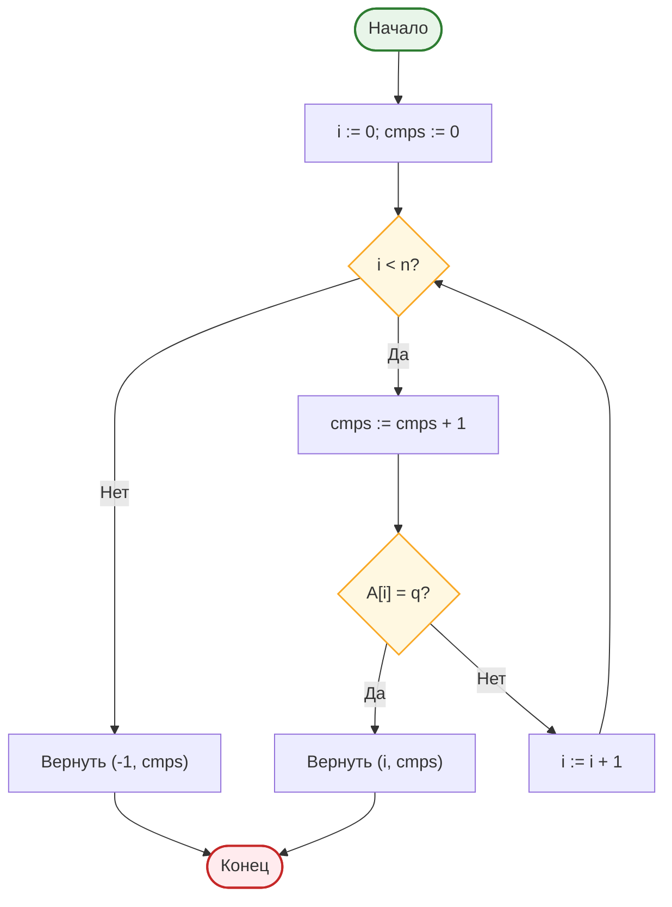
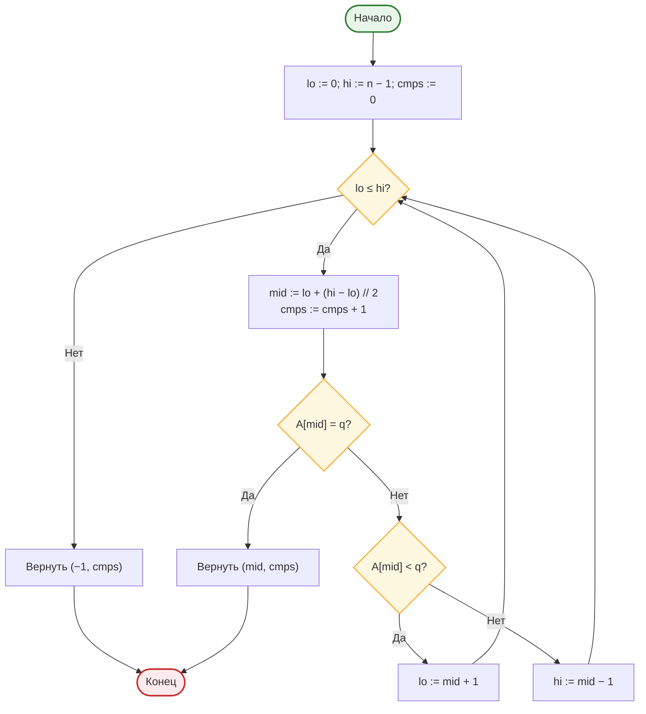
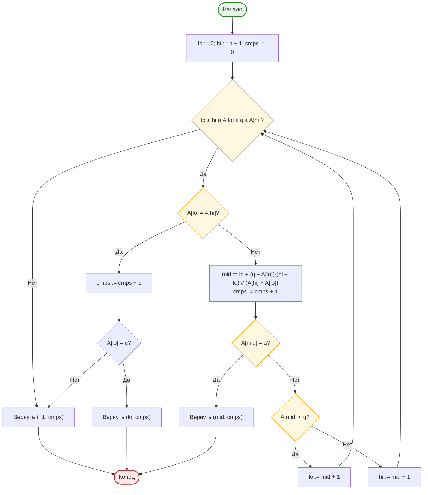

# Лабораторная работа № 4

**Анализ алгоритмов последовательного, двоичного и интерполяционного поиска**

| | |
|---|---|
| **Дисциплина** | Основы алгоритмизации и программирования |
| **Направление** | 38.03.05 «Бизнес-информатика» |
| **Курс** | 2 |
| **Группа** | БИ 2-1 |
| **Выполнила** | Осипова Анна Алексеевна |
| **Вариант** | 17 |
| **Язык реализации** | Python 3.10+ |
| **Год** | 2026 |

---

## 1. Цель работы

Изучить алгоритмы поиска элемента в массиве, экспериментально сопоставить их трудоёмкость с теоретическими оценками и определить условия, при которых предварительная сортировка данных оправдана.

**Задачи:**

1. Изучить постановку задачи поиска и оценки сложности последовательного, двоичного и интерполяционного поиска.
2. Реализовать три алгоритма поиска с подсчётом числа сравнений.
3. Измерить среднее время одного запроса при различных размерах массива.
4. Определить число запросов, начиная с которого предварительная сортировка массива окупается (доп. задание Б3).
5. Исследовать зависимость эффективности интерполяционного поиска от распределения ключей (степенное распределение).

---

## 2. Задание варианта 17

| Параметр | Значение |
|---|---|
| Размеры массива \(n\) | \(10^3 \ldots 10^5\) (5 точек): 1000; 3162; 10 000; 31 623; 100 000 |
| Распределение ключей | **С** — степенное: \(\lfloor 10^6 \cdot u^3 \rfloor\), \(u \sim U[0;1)\) |
| Число запросов \(k\) | 1500 |
| Тип запросов | успешные |
| Дополнительное задание | **Б3** — точка окупаемости сортировки |

---

## 3. Теоретическая часть

### 3.1. Постановка задачи

Дан массив \(A\) из \(n\) элементов и ключ \(q\). Требуется определить индекс \(i\), для которого \(A[i] = q\), либо установить, что такого элемента нет.

- **Успешный поиск** — ключ присутствует в массиве.
- **Неуспешный поиск** — ключ отсутствует (как правило, требует больше операций).

### 3.2. Последовательный (линейный) поиск

Элементы просматриваются подряд до совпадения либо до конца массива. Упорядоченность не требуется.

Среднее число сравнений при успешном поиске (равновероятное расположение):

\[
C_{\text{ср}} = \frac{n+1}{2} = \Theta(n).
\]

При неуспешном поиске всегда \(n\) сравнений.

### 3.3. Двоичный поиск

Применим только к **упорядоченному** массиву. На каждом шаге длина отрезка уменьшается вдвое:

\[
C_{\max} = \lfloor \log_2 n \rfloor + 1 = \Theta(\log n).
\]

Для \(n = 10^5\) достаточно \(\approx 17\) сравнений против \(\approx 5 \cdot 10^4\) у последовательного поиска.

### 3.4. Интерполяционный поиск

Пробная позиция вычисляется в предположении равномерного распределения ключей:

\[
mid = lo + \left\lfloor \frac{(q - A[lo]) \cdot (hi - lo)}{A[hi] - A[lo]} \right\rfloor.
\]

| Условие | Число сравнений |
|---|---|
| Равномерное распределение | \(O(\log \log n)\) |
| Произвольное (степенное и др.) | до \(O(n)\) |

Для варианта 17 используется **степенное** распределение — ожидается деградация интерполяционного поиска относительно двоичного.

### 3.5. Окупаемость предварительной сортировки

При \(k\) запросах:

\[
T_{\text{без}} = k \cdot c_1 n, \qquad T_{\text{с}} = c_2 n \log_2 n + k \cdot c_3 \log_2 n.
\]

Сортировка окупается при

\[
k \gtrsim \frac{c_2}{c_1}\log_2 n.
\]

Порог растёт **логарифмически** — уже при десятках запросов сортировка оправдана.

### 3.6. Сводная таблица

| Алгоритм | Упорядоченность | Лучший | Средний | Худший | Память |
|---|---|---|---|---|---|
| Последовательный | Не требуется | \(\Theta(1)\) | \(\Theta(n)\) | \(\Theta(n)\) | \(O(1)\) |
| Двоичный | Требуется | \(\Theta(1)\) | \(\Theta(\log n)\) | \(\Theta(\log n)\) | \(O(1)\) |
| Интерполяционный | Требуется | \(\Theta(1)\) | \(\Theta(\log\log n)\)* | \(\Theta(n)\) | \(O(1)\) |

\* При равномерном распределении ключей.

---

## 4. Блок-схемы алгоритмов (Mermaid)

### 4.1. Последовательный поиск



*Рисунок 1 — Блок-схема последовательного поиска*

### 4.2. Двоичный поиск



*Рисунок 2 — Блок-схема двоичного поиска*

### 4.3. Интерполяционный поиск



*Рисунок 3 — Блок-схема интерполяционного поиска*

---

## 5. Листинг программы

```python
def linear_search(a, q):
    for i, value in enumerate(a):
        if value == q:
            return i, i + 1
    return -1, len(a)


def binary_search(a, q):
    lo, hi, cmps = 0, len(a) - 1, 0
    while lo <= hi:
        mid = lo + (hi - lo) // 2
        cmps += 1
        if a[mid] == q:
            return mid, cmps
        if a[mid] < q:
            lo = mid + 1
        else:
            hi = mid - 1
    return -1, cmps


def interpolation_search(a, q):
    lo, hi, cmps = 0, len(a) - 1, 0
    while lo <= hi and a[lo] <= q <= a[hi]:
        if a[lo] == a[hi]:
            cmps += 1
            return (lo, cmps) if a[lo] == q else (-1, cmps)
        mid = lo + (q - a[lo]) * (hi - lo) // (a[hi] - a[lo])
        mid = max(lo, min(mid, hi))
        cmps += 1
        if a[mid] == q:
            return mid, cmps
        if a[mid] < q:
            lo = mid + 1
        else:
            hi = mid - 1
    return -1, cmps


def make_power_data(n, seed=42):
    """Степенное распределение С: floor(10^6 * u^3)."""
    rng = random.Random(seed + n)
    data = [int(1_000_000 * (rng.random() ** 3)) for _ in range(n)]
    data.sort()
    return data
```

Полный код экспериментов — в файле `lr4.py`.

---

## 6. Характеристики вычислительной системы

Измерения выполнены на удалённом стенде (Linux, Python 3.10+).  
Таймер — `time.perf_counter()`. Среднее время одного запроса = суммарное время серии / \(k\).  
Число сравнений усреднено по 1500 успешным запросам.

---

## 7. Результаты измерений

### 7.1. Среднее время одного запроса, мкс

| \(n\) | Последовательный | Двоичный | Интерполяционный |
|------:|-----------------:|---------:|-----------------:|
| 1 000 | 12,92 | 1,03 | 8,64 |
| 3 162 | 64,93 | 1,24 | 12,71 |
| 10 000 | 147,73 | 1,33 | 21,01 |
| 31 623 | 559,69 | 1,69 | 34,40 |
| 100 000 | 2294,91 | 1,97 | 59,71 |

### 7.2. Среднее число сравнений на один запрос

| \(n\) | Последовательный | Теория \(\frac{n+1}{2}\) | Двоичный | Теория \(\log_2 n\) | Интерполяционный |
|------:|-----------------:|-------------------------:|---------:|--------------------:|-----------------:|
| 1 000 | 507,5 | 500,5 | 9,0 | 10,0 | 22,5 |
| 3 162 | 1588,3 | 1581,5 | 10,6 | 11,6 | 33,9 |
| 10 000 | 5075,3 | 5000,5 | 12,2 | 13,3 | 49,8 |
| 31 623 | 15 873,9 | 15 812,0 | 13,7 | 15,0 | 78,0 |
| 100 000 | 50 343,2 | 50 000,5 | 15,0 | 16,6 | 108,0 |

### 7.3. Анализ

1. Число сравнений последовательного поиска близко к \(\frac{n+1}{2}\) — теория подтверждена.
2. Двоичный поиск: число сравнений \(\approx \log_2 n\), время растёт крайне медленно (с 1,03 до 1,97 мкс при росте \(n\) в 100 раз).
3. **Интерполяционный поиск на степенном распределении деградирует**: число сравнений растёт примерно как \(\Theta(\sqrt[3]{n})\) и уже при \(n = 10^3\) превышает двоичный поиск. Это ожидаемо: формула пробной позиции предполагает равномерность, которой нет при \(u^3\).

---

## 8. Дополнительное задание Б3 — точка окупаемости сортировки

Фиксированный размер \(n = 100\,000\). Сравниваются две стратегии:

- **Без сортировки:** \(T = k \cdot t_{\text{lin}}\) (последовательный поиск по неотсортированному массиву).
- **С сортировкой:** \(T = t_{\text{sort}} + k \cdot t_{\text{bin}}\) (один раз Timsort + двоичный поиск).

| Параметр | Значение |
|---|---|
| \(t_{\text{lin}}\) | 1482,3 мкс/запрос |
| \(t_{\text{bin}}\) | 2,53 мкс/запрос |
| \(t_{\text{sort}}\) | 25,3 мс |
| **\(k^*\) (пересечение)** | **≈ 17,1** |

Уже при **~17 запросах** предварительная сортировка окупается. При \(k = 1500\) (как в основном эксперименте) стратегия с сортировкой быстрее примерно в 90 раз.

Это объясняет, почему в базах данных поддерживаются индексы: затраты на построение однократны, а выигрыш получает каждый запрос.

---

## 9. Выводы

1. Экспериментальные данные подтверждают теоретические оценки: последовательный поиск — \(\Theta(n)\), двоичный — \(\Theta(\log n)\).
2. На **степенном** распределении ключей интерполяционный поиск **не даёт** выигрыша и уступает двоичному как по числу сравнений, так и по времени. Вывод о превосходстве интерполяции справедлив лишь для равномерных данных.
3. Точка окупаемости сортировки при \(n = 10^5\) составляет всего **\(k^* \approx 17\)**. Порог растёт логарифмически — предварительная сортировка (или индекс) оправдана уже при небольшом числе запросов.
4. В прикладных системах для многократного поиска по большим данным следует поддерживать упорядоченную структуру (сортировка, индекс, `bisect`), а не выполнять линейный просмотр.

---

## 10. Контрольные вопросы

**1. Задача поиска. Успешный и неуспешный поиск.**  
Найти индекс элемента с заданным ключом или установить отсутствие. Неуспешный поиск обычно требует полного просмотра (линейный) или доведения отрезка до пустого (двоичный) — чаще больше операций.

**2. Среднее число сравнений последовательного поиска.**  
При равновероятном расположении ключа: \(C = (1+2+\ldots+n)/n = (n+1)/2\).

**3. Барьерный элемент.**  
В конец массива записывается искомый ключ — цикл гарантированно завершится, проверка границы становится лишней. Асимптотика \(\Theta(n)\) не меняется.

**4. Почему двоичный поиск требует упорядоченного массива.**  
Решение «идти влево/вправо» основано на упорядоченности; на неотсортированных данных результат некорректен.

**5. Число сравнений двоичного поиска при \(n = 10^6\).**  
\(\lfloor\log_2 10^6\rfloor + 1 \approx 20\).

**6. Пробная позиция интерполяционного поиска.**  
Линейная интерполяция позиции ключа в предположении равномерного распределения значений на отрезке \([A[lo]; A[hi]]\).

**7. Когда интерполяция деградирует до \(\Theta(n)\).**  
При сильно неравномерном распределении (степенное, кластерное): пробная позиция систематически «промахивается».

**8. Условие окупаемости сортировки.**  
\(k > \dfrac{c_2 n\log n}{c_1 n - c_3\log n} \approx \dfrac{c_2}{c_1}\log n\). Порог логарифмический.

**9. Индексы в БД.**  
Ускоряют выборку (поиск по индексу \(O(\log n)\)), но замедляют вставку/обновление (нужно поддерживать упорядоченность индекса).

**10. Все вхождения ключа за \(O(\log n + m)\).**  
Двоичным поиском найти первое и последнее вхождение (левая/правая граница), затем выдать отрезок длины \(m\).

---

## 11. Рекомендуемая литература

1. Вирт Н. Алгоритмы и структуры данных. — М.: ДМК Пресс, 2016.
2. Кнут Д. Э. Искусство программирования. Т. 3. Сортировка и поиск. — 2-е изд. — М.: Вильямс, 2017.
3. Кормен Т. и др. Алгоритмы: построение и анализ. — 3-е изд. — М.: Вильямс, 2013.
4. Седжвик Р., Уэйн К. Алгоритмы на Java. — 4-е изд. — М.: Вильямс, 2013. — Гл. 3.
5. Документация Python: модуль `bisect` — https://docs.python.org/3/library/bisect.html

---

*Лабораторная работа № 4 • Осипова Анна Алексеевна • Вариант 17 • 2026*
